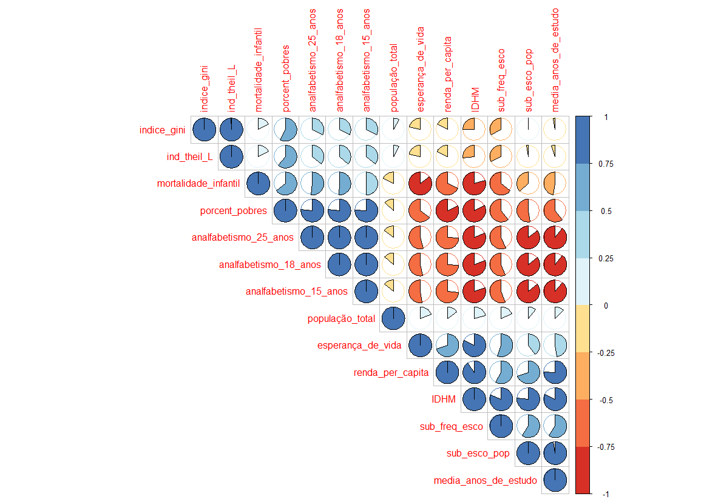
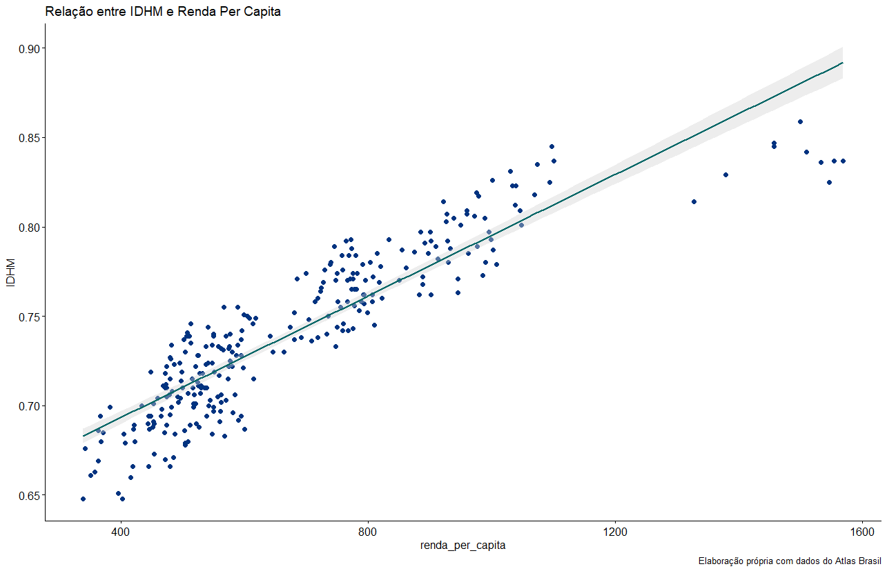
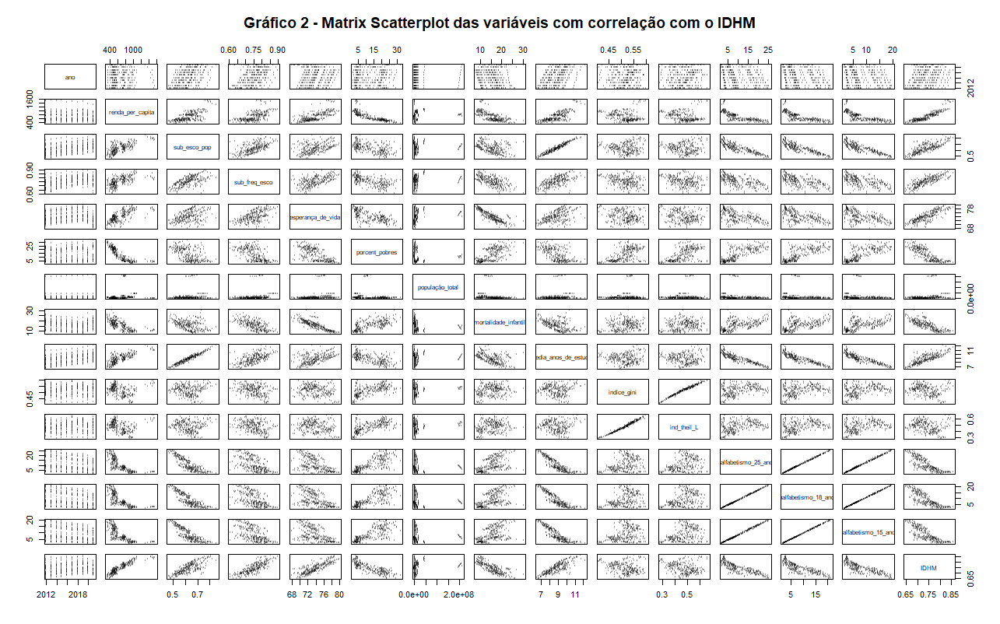

# Previsão do IDHM com Machine Learning — Random Forest em R

**Trabalho de Conclusão de Curso | UFMS · Ciências Econômicas · 2023**


---


---

## Abrir o HTML no navegador

[Baixe o ZIP do repositório](https://github.com/matheusassiso/Machine-Learning-predi-o-do-IDHM/archive/refs/heads/main.zip), extraia o conteúdo e abra [`docs/dashboard_eda.html`](docs/dashboard_eda.html) no navegador.

Os gráficos e a tabela interativa carregam bibliotecas pela internet.

O painel apresenta a série temporal do IDHM por estado, correlações, dispersão com regressão, distribuições e a tabela completa. Na série temporal, selecione os estados que deseja comparar. Na dispersão, escolha a variável no eixo X, o agrupamento por cor e o ano. As seções de dados e análise exploratória abaixo documentam as variáveis e os resultados.

## Visão Geral

Este projeto aplica o algoritmo **Random Forest** para prever o **Índice de Desenvolvimento Humano Municipal (IDHM)** dos estados brasileiros no período de **2012 a 2021**, utilizando dados socioeconômicos disponibilizados pelo Atlas Brasil (IBGE/PNUD).

O trabalho foi desenvolvido como Trabalho de Conclusão de Curso do Bacharelado em Ciências Econômicas da Universidade Federal de Mato Grosso do Sul (UFMS), sob orientação do Prof. Dr. Adriano Marcos Rodrigues Figueiredo.

O projeto é uma adaptação brasileira do trabalho de **Julie Anne Hockensmith** — [Predicting the Human Development Index](https://github.com/julieanneco/predictingHDI) — que utilizou dados do Banco Mundial via API do pacote `WDI` para prever o IDH global. Aqui, adaptamos a metodologia para o IDHM brasileiro, utilizando dados estaduais do Atlas Brasil e o pacote `randomForest` em R.

---

## O que é o IDHM?

O IDHM é uma adaptação brasileira do IDH (Índice de Desenvolvimento Humano), publicado pelo PNUD. Diferente do IDH global, o IDHM é calculado para municípios e estados brasileiros, medindo três dimensões do desenvolvimento humano:

| Dimensão | O que mede | Indicadores usados neste estudo |
|---|---|---|
| **Educação** | Acesso ao conhecimento | Escolaridade da população adulta, fluxo escolar jovem, taxa de analfabetismo, média de anos de estudo |
| **Longevidade** | Vida longa e saudável | Esperança de vida ao nascer, mortalidade infantil |
| **Renda** | Padrão de vida digno | Renda *per capita*, percentual de pobres |

O índice varia de 0 a 1 — quanto mais próximo de 1, maior o desenvolvimento humano. No período analisado (2012–2021), os estados brasileiros apresentaram IDHM entre **0,65** (estados do Nordeste) e **0,86** (Distrito Federal).

---

## Contexto e Motivação

O Machine Learning tem conquistado espaço crescente na econometria, com economistas como **Susan Athey** (Stanford) e **Guido Imbens** (Nobel 2021) demonstrando seu potencial para análise de dados econômicos complexos. O Random Forest, em particular, é adequado para dados socioeconômicos por:

- Capturar interações não-lineares entre variáveis sem especificação prévia
- Lidar com multicolinearidade (comum em indicadores socioeconômicos)
- Fornecer uma medida natural de importância de variáveis
- Ser robusto ao *overfitting*

A aplicação ao IDHM responde a uma questão prática: **quais indicadores socioeconômicos são mais determinantes para o desenvolvimento humano dos estados brasileiros?**

---

## Dados

- **Fonte:** [Atlas Brasil](http://www.atlasbrasil.org.br/acervo/atlas) — dados do IBGE e Registros Administrativos
- **Abrangência:** 27 unidades federativas (26 estados + DF) + Brasil agregado = 28 territorialidades
- **Período:** 2012 a 2021 (10 anos)
- **Total:** 280 observações

**Variáveis coletadas (17 no total):**

```
Variável-alvo:
  IDHM                        Índice de Desenvolvimento Humano Municipal

Dimensão Educação:
  sub_esco_pop                Subíndice de escolaridade da população adulta
  sub_freq_esco               Subíndice de frequência de escolaridade jovem
  media_anos_de_estudo        Média de anos de estudo (25 anos ou mais)
  analfabetismo_15_anos       Taxa de analfabetismo — 15 anos ou mais
  analfabetismo_18_anos       Taxa de analfabetismo — 18 anos ou mais
  analfabetismo_25_anos       Taxa de analfabetismo — 25 anos ou mais

Dimensão Longevidade:
  esperança_de_vida           Esperança de vida ao nascer
  mortalidade_infantil        Mortalidade infantil (por 1.000 nascidos vivos)

Dimensão Renda:
  renda_per_capita            Renda per capita (R$)
  porcent_pobres              % da população com renda per capita < R$ 140/mês

Desigualdade e Contexto:
  indice_gini                 Índice de Gini
  ind_theil_L                 Índice de Theil L
  populacao_total             População total do estado
```

Todos os dados estão na pasta [`data/`](data/).

---

## Etapa 1 — Engenharia de Dados

**Script:** [`scripts/01_engenharia_dados.R`](scripts/01_engenharia_dados.R) | **Notebook:** [`notebooks/IDHM_01_Engenharia_Dados.Rmd`](notebooks/IDHM_01_Engenharia_Dados.Rmd)

Os dados foram obtidos do Atlas Brasil em formato `.xlsx`, com uma coluna por ano (formato *wide*). O pipeline de engenharia de dados:

**1. Importação e pivotamento para formato *tidy*:**

```r
library(readxl)
library(tidyr)

renda_per_capita <- read_excel("data/renda_per_capita.xlsx")

# Converter colunas de anos em formato longo (tidy)
renda_per_capita <- gather(renda_per_capita, ano, renda_per_capita, X2012:X2021, convert = TRUE)

# Remover o "X" prefixado nos anos e converter para numérico
renda_per_capita$ano <- gsub('X', '', renda_per_capita$ano)
renda_per_capita <- transform(renda_per_capita, ano = as.numeric(ano))
renda_per_capita <- transform(renda_per_capita, renda_per_capita = as.numeric(renda_per_capita))
```

**2. Junção em data frame único (`IDHM.AED`) — 280 obs. x 16 variáveis:**

```r
library(plyr)

IDHM.AED = renda_per_capita
IDHM.AED <- join(IDHM.AED, sub_esco_pop,   by = c("ano" = "ano", "Territorialidades" = "Territorialidades"))
IDHM.AED <- join(IDHM.AED, sub_freq_esco,  by = c("ano" = "ano", "Territorialidades" = "Territorialidades"))
# ... (todos os 13 indicadores)
IDHM.AED <- join(IDHM.AED, IDHM,           by = c("ano" = "ano", "Territorialidades" = "Territorialidades"))
```

**3. Validação:** Nenhum valor nulo (`NA`) encontrado. A função `sapply` confirmou os valores únicos esperados: 28 territorialidades, 10 anos (2012–2021), 280 observações totais.

---

## Etapa 2 — Análise Exploratória de Dados (AED)

**Script:** [`scripts/02_analise_exploratoria.R`](scripts/02_analise_exploratoria.R) | **Notebook:** [`notebooks/IDHM_02_Analise_Exploratoria.Rmd`](notebooks/IDHM_02_Analise_Exploratoria.Rmd)

### 2.1 Matriz de Correlação

A primeira visualização foi uma matriz de correlação entre todos os indicadores, usando o pacote `corrplot` com agrupamento hierárquico:

```r
library(corrplot)
library(RColorBrewer)

AED.corr <- AED.df[cc,]
AED.corr$Territorialidades <- NULL
AED.corr$ano <- NULL

Matrix <- cor(AED.corr)
corrplot(Matrix, type = "upper", order = "hclust", method = "pie",
         col = brewer.pal(n = 8, name = "RdYlBu"))
```



**Achados principais:**
- **Correlação positiva forte com o IDHM:** renda *per capita*, subíndices de educação, esperança de vida e média de anos de estudo
- **Correlação negativa forte:** taxas de analfabetismo, mortalidade infantil, percentual de pobres
- **Correlação fraca:** índice de Gini (R² ≈ 0,06), índice de Theil L (R² ≈ 0,07) e população total (R² ≈ 0,04)

### 2.2 Scatterplots e Regressões Lineares Univariadas

Para cada variável, foi plotado um *scatterplot* com linha de tendência e realizada uma regressão linear simples para quantificar o poder explicativo individual:

```r
library(ggplot2)
library(ggpubr)

ggscatter(predic.IDHM, x = "renda_per_capita", y = "IDHM",
          color = rgb(0, .2, .5, 1), pch = 1, add = "reg.line",
          add.params = list(color = rgb(0, .4, .4, 1), fill = "light gray"),
          conf.int = TRUE,
          main = "Relação entre IDHM e Renda Per Capita") +
  labs(title   = "Relação entre IDHM e Renda Per Capita",
       subtitle = "Análise baseada em dados do Atlas Brasil",
       caption  = "Fonte: Elaboração própria com dados do Atlas Brasil") +
  theme(plot.caption = element_text(hjust = 0, face = "italic"))
```



**R² das regressões lineares simples — variáveis selecionadas:**

| Variável | R² | p-valor |
|---|:---:|:---:|
| Renda *per capita* | **0,816** | < 0,001 |
| Esperança de vida | ~0,65 | < 0,001 |
| Subíndice de frequência de escolaridade | ~0,60 | < 0,001 |
| Taxas de analfabetismo | ~0,50 | < 0,001 |
| Mortalidade infantil | ~0,55 | < 0,001 |
| **Índice de Gini** | **0,043** | < 0,001 |
| **Índice de Theil L** | **0,071** | < 0,001 |
| **População total** | **0,044** | < 0,001 |

### 2.3 Seleção de Variáveis para o Modelo

Com base nas correlações e regressões lineares, optou-se por **remover** do modelo final as variáveis com baixo poder explicativo:

```r
library(dplyr)
predic.IDHM <- select(predic.IDHM, -ind_theil_L, -indice_gini, -populacao_total)
```

O data frame final (`predic.IDHM`) possui **280 observações × 12 variáveis** (11 preditoras + 1 variável-alvo IDHM).

---

## Etapa 3 — Modelagem com Random Forest

**Script:** [`scripts/03_random_forest_modelo.R`](scripts/03_random_forest_modelo.R) | **Notebook:** [`notebooks/IDHM_ML_Completo.Rmd`](notebooks/IDHM_ML_Completo.Rmd)

### 3.1 Partição Treino/Teste (80/20)

```r
library(caTools)
library(caret)

set.seed(123)
amostra.IDHM <- predic.IDHM$IDHM %>%
  createDataPartition(p = 0.8, list = FALSE)

treino.IDHM <- predic.IDHM[amostra.IDHM, ]   # 224 observações
teste.IDHM  <- predic.IDHM[-amostra.IDHM, ]  # 56 observações
```

### 3.2 Modelo 1 — Random Forest (mtry = 3)

```r
library(randomForest)

IDHM.model.1 <- randomForest(IDHM ~ .,
                              data       = treino.IDHM,
                              ntree      = 500,
                              mtry       = 3,
                              importance = TRUE,
                              na.action  = na.omit)
print(IDHM.model.1)
```

```
## randomForest(formula = IDHM ~ ., data = treino.IDHM, ntree = 500, mtry = 3, importance = TRUE, na.action = na.omit)
##                Type of random forest: regression
##                      Number of trees: 500
## No. of variables tried at each split: 3
##
##           Mean of squared residuals: 5.068181e-05
##                     % Var explained: 97.6
```

O gráfico abaixo mostra que o erro se estabiliza a partir de ~150 árvores, confirmando que 500 é suficiente:

### 3.3 Otimização do Hiperparâmetro `mtry` com `tuneRF`

```r
mtry <- tuneRF(treino.IDHM[-6], treino.IDHM$IDHM,
               ntreeTry   = 500,
               stepFactor = 1,
               improve    = 0.01,
               trace      = TRUE,
               plot       = FALSE)
print(mtry)
## mtry  OOBError
##  3    1.782552e-05
```

A função `tuneRF` confirmou **`mtry = 3`** como o valor que minimiza o erro OOB. Para fins comparativos, um segundo modelo foi treinado com `mtry = 4`:

### 3.4 Modelo 2 — Random Forest (mtry = 4)

```r
set.seed(123)
IDHM.model.2 <- randomForest(IDHM ~ .,
                              data       = treino.IDHM,
                              ntree      = 500,
                              mtry       = 4,
                              importance = TRUE,
                              na.action  = na.omit)
```

```
##   Mean of squared residuals: 4.829864e-05
##             % Var explained: 97.71
```

---

## Resultados

### Comparativo de Desempenho

| Modelo | `ntree` | `mtry` | % Variância Explicada | RMSE |
|---|:---:|:---:|:---:|:---:|
| **Modelo 1** | 500 | 3 | **97,60%** | **0,00842** |
| **Modelo 2** | 500 | 4 | **97,71%** | **0,00817** |
| Modelo 90/10 (ref.) | 500 | 3 | 97,52% | 0,00601 |

> O IDHM varia de 0 a 1. Um RMSE de ~0,008 representa erro médio **inferior a 1 ponto percentual**, demonstrando excelente capacidade preditiva. A mudança na divisão 90/10, apesar de reduzir o RMSE, diminuiu o percentual de variância explicada.

### Importância das Variáveis

```r
importance(IDHM.model.1)
##                        %IncMSE  IncNodePurity
## ano                   7.868941   0.002079949
## renda_per_capita     23.030204   0.136166918
## sub_esco_pop         20.115061   0.016921115
## sub_freq_esco        21.777708   0.029760092
## esperança_de_vida    19.615980   0.045243865
## porcent_pobres       13.947132   0.063730867
## mortalidade_infantil 16.330721   0.056961273
## media_anos_de_estudo 19.724511   0.025218818
## analfabetismo_25_anos 12.473426  0.040472876
## analfabetismo_18_anos 13.835095  0.030522313
## analfabetismo_15_anos 11.938146  0.024789071
```

**Top 5 variáveis por %IncMSE (Modelo 1):**

| Rank | Variável | %IncMSE | Interpretação |
|:---:|---|:---:|---|
| 1 | Renda *per capita* | **23,03** | Maior impacto — remoção aleatória eleva erro em 23% |
| 2 | Subíndice freq. escolaridade | **21,78** | Frequência escolar jovem — dimensão educação |
| 3 | Subíndice escolaridade pop. | **20,12** | Escolaridade adulta — dimensão educação |
| 4 | Média de anos de estudo | **19,72** | Capital humano acumulado |
| 5 | Esperança de vida | **19,62** | Dimensão longevidade |

> **Destaque:** A variável `ano` apresentou a menor importância relativa (%IncMSE = 7,87), indicando que as dimensões socioeconômicas têm maior poder preditivo sobre o IDHM do que a tendência temporal isolada.

### Predição vs. Valores Reais

```r
IDHM.predicoes.1 <- IDHM.model.1 %>% predict(teste.IDHM)
RMSE(IDHM.predicoes.1, teste.IDHM$IDHM)
## [1] 0.008417118
```



*Linha vermelha = predições do modelo | Linha preta = valores reais do IDHM. A proximidade entre as linhas evidencia o alto ajuste do modelo.*

A média da diferença entre predições e valores reais foi de **-0,00127523** — praticamente zero — confirmando que o modelo não apresenta viés sistemático.

---

## Estrutura do Repositório

```
.
├── data/                           # Datasets (.xlsx) — Atlas Brasil/IBGE
│   ├── IDHM.xlsx
│   ├── renda_per_capita.xlsx
│   ├── IDHM_educacao.xlsx
│   ├── IDHM_longevidade.xlsx
│   ├── IDHM_renda.xlsx
│   ├── esperanca_de_vida.xlsx
│   ├── mortalidade_infantil.xlsx
│   ├── media_anos_de_estudo.xlsx
│   ├── sub_esco_pop.xlsx
│   ├── sub_freq_esco.xlsx
│   ├── porcent_pobres.xlsx
│   ├── populacao_total.xlsx
│   ├── analfabetismo_15_anos.xlsx
│   ├── analfabetismo_18_anos.xlsx
│   ├── analfabetismo_25_anos.xlsx
│   ├── indice_gini.xlsx
│   └── ind_theil_L.xlsx
│
├── scripts/                        # Scripts R por etapa do pipeline
│   ├── 01_engenharia_dados.R       # Importação, limpeza e join dos dados
│   ├── 02_analise_exploratoria.R   # AED, matrizes de correlação e scatterplots
│   ├── 03_random_forest_modelo.R   # Treinamento, tuning e comparação de modelos
│   └── 04_predicao_avaliacao.R     # Predições, RMSE e visualização final
│
├── notebooks/                      # R Markdown — análise documentada e reproduzível
│   ├── IDHM_ML_Completo.Rmd        # Pipeline completo (análise principal)
│   ├── IDHM_01_Engenharia_Dados.Rmd
│   ├── IDHM_02_Analise_Exploratoria.Rmd
│   └── IDHM_ML_90_10.Rmd           # Modelo comparativo (divisão 90/10)
│
├── outputs/                        # Visualizações geradas
│   ├── matriz_correlacao_IDHM.png
│   ├── matriz_correlacao.png
│   ├── relacao_IDHM_renda_per_capita.png
│   ├── relacao_IDHM_sub_escolaridade.png
│   └── variacao_predicao_IDHM.png
│
├── predicting IDHM.Rproj           # Projeto RStudio
├── .gitignore
└── README.md
```

---

## Como Reproduzir

### Pré-requisitos

- R (>= 4.0) e RStudio

### Instalação dos pacotes

```r
install.packages(c(
  "tidyr", "readxl", "plyr", "dplyr",
  "corrplot", "RColorBrewer", "ggplot2", "ggpubr",
  "caret", "randomForest", "caTools"
), dependencies = TRUE)
```

### Execução

1. Clone o repositório e abra `predicting IDHM.Rproj` no RStudio
2. Execute os scripts na sequência numérica (`01` → `02` → `03` → `04`)
3. Ou acesse `notebooks/IDHM_ML_Completo.Rmd` para a análise completa e documentada

---

## Referência Acadêmica

```
OLIVEIRA, Matheus Assis de. Aplicação do Machine Learning na Previsão de Índices
Econômicos: O IDHM com o Modelo Random Forest de 2012 à 2021. Trabalho de Conclusão
de Curso (Bacharelado em Ciências Econômicas) — Escola de Administração e Negócios,
Universidade Federal de Mato Grosso do Sul, Campo Grande, 2023.
```

**Projeto de referência:** HOCKENSMITH, Julie Anne. *Predicting the Human Development Index*. Disponível em: https://github.com/julieanneco/predictingHDI

---

## Contato

**Matheus Assis de Oliveira**
Bacharel em Ciências Econômicas — UFMS

[](mailto:matheusassiso687@gmail.com)
[](https://github.com/matheusassiso)
